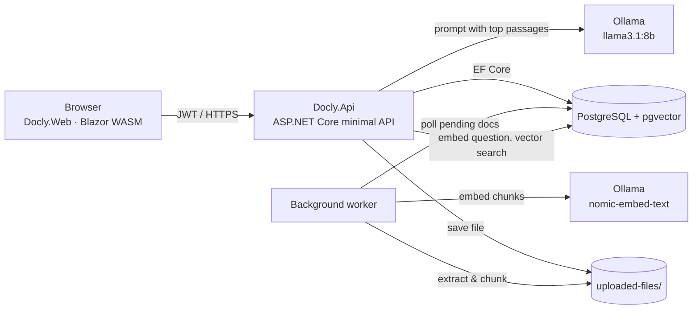

# Docly

**Chat with your documents — privately, on your own machine.**

Docly lets you upload PDFs, Word documents and text files, then ask questions about them in plain language.
Answers are generated by a local LLM (via [Ollama](https://ollama.com)) using only the passages retrieved from *your* files,
and every answer lists the documents it came from. Nothing leaves your machine.


---

## Contents

- [Features](#features)
- [How it works](#how-it-works)
- [Tech stack](#tech-stack)
- [Prerequisites](#prerequisites)
- [Quick start](#quick-start)
- [Run everything with Docker Compose](#run-everything-with-docker-compose)
- [Configuration](#configuration)
- [Using Docly](#using-docly)
- [API reference](#api-reference)
- [Project structure](#project-structure)
- [Running tests](#running-tests)
- [Troubleshooting](#troubleshooting)
- [Known limitations](#known-limitations)
- [Contributing](#contributing)

---

## Features

- 📄 **Upload** PDF, DOCX and TXT files (up to 25 MB) by click or drag-and-drop
- ⚙️ **Automatic indexing** in the background: extract text → split into passages → embed → store in pgvector, with live progress in the UI
- 💬 **Ask questions** in a modern chat interface; answers render as Markdown with source chips and similarity scores
- 🗂️ **Conversation history** grouped by date, searchable, deletable; follow-up questions understand the conversation
- 🔁 **Library management**: live indexing progress, retry failed documents, delete documents
- 🔐 **Accounts** with JWT authentication; every user only sees their own documents and chats
- 🌗 **Light and dark themes**, responsive down to phone width
- 🏠 **Fully local**: PostgreSQL + Ollama, no cloud API keys

## How it works



1. **Upload** — the API stores the file on disk and creates a `Document` row with status `PendingExtraction`.
2. **Index** — a background service is woken immediately (and also polls every 30 s): extracts text (PdfPig / OpenXML), splits it into ~1000-character
   overlapping chunks, and gets 768-dimension embeddings from `nomic-embed-text` (batched). If the app restarts mid-way, interrupted documents are re-queued automatically.
3. **Ask** — your question is embedded the same way, the closest chunks (cosine distance) from *your* documents are retrieved,
   and `llama3.1:8b` is asked to answer using only those chunks (numbered so it can cite them), together with the last few messages of the conversation.
4. **History** — the question, answer and sources are saved to the conversation.

## Tech stack

| Layer | Technology |
|---|---|
| Frontend | Blazor WebAssembly (.NET 10), Markdig for Markdown |
| Backend | ASP.NET Core minimal APIs (.NET 10), JWT bearer auth, rate limiting |
| Data | PostgreSQL 15+ with the **pgvector** extension, EF Core 10 + Npgsql |
| AI | Ollama — `nomic-embed-text` (embeddings) and `llama3.1:8b` (answers) |
| Text extraction | PdfPig (PDF), DocumentFormat.OpenXml (DOCX) |

---

## Prerequisites

Install these first:

| Tool | Version | Check | Get it |
|---|---|---|---|
| .NET SDK | **10.0** or newer | `dotnet --version` | https://dotnet.microsoft.com/download |
| EF Core CLI | 10.x | `dotnet ef --version` | nothing to install — `dotnet tool restore` (step 6) fetches the pinned version |
| PostgreSQL + pgvector | 15+ | `psql --version` | Docker image (recommended, below) or https://github.com/pgvector/pgvector |
| Ollama | latest | `ollama --version` | https://ollama.com/download |
| Git | any | `git --version` | https://git-scm.com |

Optional: **Docker Desktop** (easiest way to get PostgreSQL with pgvector), Visual Studio 2022 17.14+ / Rider / VS Code with C# Dev Kit.

> **Hardware:** `llama3.1:8b` needs roughly 8 GB of free RAM (a GPU makes answers much faster). On smaller machines use a
> smaller model — see [Configuration](#changing-the-ai-models).

---

## Quick start

### 1. Clone the repository

```bash
git clone https://github.com/<your-username>/Docly.git
cd Docly
```

### 2. Start PostgreSQL with pgvector

**Option A — Docker (recommended)**

```bash
docker run -d --name docly-db -e POSTGRES_PASSWORD=postgres -e POSTGRES_DB=docassistant -p 5432:5432 -v docly-pgdata:/var/lib/postgresql/data pgvector/pgvector:pg17
```

**Option B — existing PostgreSQL install**

Install the pgvector extension for your PostgreSQL version ([instructions](https://github.com/pgvector/pgvector#installation)), then create the database:

```sql
CREATE DATABASE docassistant;
```

The migrations run `CREATE EXTENSION IF NOT EXISTS vector` themselves, so no extra step is needed as long as pgvector is installed and the database user is allowed to create extensions (the default `postgres` superuser is).

### 3. Install Ollama and pull the models

```bash
ollama pull nomic-embed-text
```

```bash
ollama pull llama3.1:8b
```

Make sure Ollama is running (the desktop app starts it automatically, otherwise run `ollama serve`). Check it:

```bash
curl http://localhost:11434/api/tags
```

### 4. Configure your local secrets

Docly reads settings from `Docly.Api/appsettings*.json`, and **user-secrets override them**. The committed files contain
no passwords or keys on purpose — you must provide two values. From the repository root:

```bash
dotnet user-secrets init --project Docly.Api
```

```bash
dotnet user-secrets set "ConnectionStrings:DefaultConnection" "Host=localhost;Port=5432;Database=docassistant;Username=postgres;Password=postgres" --project Docly.Api
```

Generate your own JWT signing key (any random string of **at least 32 characters**). For example `openssl rand -base64 48`,
or in PowerShell `[Convert]::ToBase64String((1..48 | % { Get-Random -Max 256 }))`. Then:

```bash
dotnet user-secrets set "Jwt:Key" "<paste-your-random-key-here>" --project Docly.Api
```

Uploaded files are stored in `uploaded-files/` next to the API by default. To use another folder:
`dotnet user-secrets set "FileStorage:RootPath" "/path/to/folder" --project Docly.Api`.

> If `Jwt:Key` is missing or too short the API refuses to start and tells you exactly what to set.

### 5. Trust the HTTPS development certificate

The web app calls the API over `https://localhost:7103`, so the dev certificate must be trusted (one-time):

```bash
dotnet dev-certs https --trust
```

> Linux: `--trust` is not supported for all distros; see the [docs](https://learn.microsoft.com/aspnet/core/security/enforcing-ssl#trust-https-certificate-on-linux).

### 6. Create the database tables

The EF Core CLI is pinned as a local tool, so there is nothing to install globally:

```bash
dotnet tool restore
```

```bash
dotnet ef database update --project Docly.Infra --startup-project Docly.Api
```

(In Development the API also applies pending migrations by itself on startup, so this step is optional — it's
useful to see errors early. Set `Database:MigrateOnStartup` to `false` to turn that off.)

### 7. Run the API and the web app

Open **two terminals** in the repository root.

Terminal 1 — API (must use the `Docly` profile so it listens on HTTPS port 7103):

```bash
dotnet run --project Docly.Api --launch-profile Docly
```

Terminal 2 — Web UI:

```bash
dotnet run --project Docly.Web --launch-profile http
```

Open **http://localhost:5201** in your browser. 🎉

API docs (Swagger UI) are at **https://localhost:7103/swagger** in Development.

> **Visual Studio:** open `Docly.slnx`, pick the launch profile **"Docly.Api + Docly.Web"** (from `Docly.slnLaunch`) and press F5 — both projects start together.

Check that everything is wired up: **https://localhost:7103/health** reports `Healthy` when PostgreSQL and Ollama are
reachable, and `Degraded` (with the reason, e.g. a model that hasn't been pulled) when Ollama needs attention.

### Ports at a glance

| Service | URL |
|---|---|
| Web UI | http://localhost:5201 (or https://localhost:7201 with the `https` profile) |
| API | https://localhost:7103 · http://localhost:5022 |
| Swagger | https://localhost:7103/swagger |
| PostgreSQL | localhost:5432 |
| Ollama | http://localhost:11434 |

## Run everything with Docker Compose

Prefer not to install .NET, PostgreSQL and Ollama yourself? One command starts the whole stack
(PostgreSQL + pgvector, Ollama, the API and the web UI):

```bash
cp .env.example .env
```

Edit `.env`: set `POSTGRES_PASSWORD` and a `JWT_KEY` of 32+ random characters. Then:

```bash
docker compose up -d --build
```

Pull the models into the Ollama container (one time, a few GB):

```bash
docker compose exec ollama ollama pull nomic-embed-text
```

```bash
docker compose exec ollama ollama pull llama3.1:8b
```

Open **http://localhost:8081**. The API is on http://localhost:8080 (health: `/health`). Uploads, the database and the
models live in Docker volumes, so they survive restarts. To reach Docly from another machine, set `WEB_ORIGIN` and
`API_BASE_URL` in `.env` to the public addresses of the web and API containers.

> The API creates/upgrades the database schema itself on startup in this setup (`Database__MigrateOnStartup`).
> NVIDIA GPU users can enable the GPU block in `docker-compose.yml`.

---

## Configuration

All API settings live in `Docly.Api/appsettings.json` and can be overridden by user-secrets or environment variables
(use `__` instead of `:` — e.g. `Jwt__Key`).

| Key | Default | Description |
|---|---|---|
| `ConnectionStrings:DefaultConnection` | `Host=localhost;Port=5432;Database=docassistant;Username=postgres` | PostgreSQL connection string — add the password via user-secrets |
| `Jwt:Key` | *(required)* | HMAC signing key, ≥ 32 chars. **Never commit a real one.** |
| `Jwt:Issuer` / `Jwt:Audience` | `DoclyApi` / `DoclyApiUsers` | Token issuer / audience |
| `Jwt:ExpiryMinutes` | `60` | Token lifetime — you'll be signed out after this |
| `FileStorage:RootPath` | `uploaded-files` | Upload folder (relative paths resolve against the API's folder) |
| `Database:MigrateOnStartup` | `false` (`true` in Development and Docker) | Apply EF migrations when the API starts |
| `Ollama:BaseUrl` | `http://localhost:11434` | Where Ollama is listening |
| `Ollama:ChatModel` | `llama3.1:8b` | Model that writes answers |
| `Ollama:EmbeddingModel` | `nomic-embed-text` | Model that creates embeddings |
| `Ollama:EmbeddingDimensions` | `768` | Must match the database column (see below) |
| `Ollama:ChatTimeoutSeconds` / `EmbeddingTimeoutSeconds` | `180` / `60` | Per-request timeouts |
| `Rag:DefaultTopN` / `MaxTopN` | `5` / `10` | Passages sent to the model per question |
| `Rag:MinSimilarity` | `0.3` | Passages less similar than this are ignored (if none pass, Docly says it found nothing) |
| `Rag:HistoryMessages` | `6` | Earlier messages sent to the model so follow-ups make sense |
| `WebClientOrigins` | `https://localhost:7201`, `http://localhost:5201` | CORS origins allowed to call the API |
| `UseHttpsRedirection` | `true` | Set `false` behind a TLS-terminating proxy or in plain-HTTP containers |

The web app has one setting, in `Docly.Web/wwwroot/appsettings.json`:

| Key | Default | Description |
|---|---|---|
| `ApiBaseUrl` | `https://localhost:7103` | Base URL of Docly.Api |

> If you serve the web app from a different port or host, add that origin to `WebClientOrigins` in the API, or the
> browser will block requests (CORS).

### Changing the AI models

Set `Ollama:ChatModel` to any chat model you have pulled (e.g. `llama3.2:3b` for low-RAM machines, `qwen2.5:7b`, `mistral`) — no code change needed.

The **embedding** model must produce **768-dimension** vectors (the `vector(768)` column); the API refuses to start otherwise.
Embedding models with a different size need a new migration and a full re-index. `nomic-embed-text` expects the
`search_document:` / `search_query:` prefixes, which Docly adds (`Ollama:DocumentPrefix` / `QueryPrefix`; set both to empty for models that don't use them).
After changing the embedding model, re-index existing documents (delete and re-upload, or set their status back to `PendingExtraction`).

## Using Docly

1. **Create an account** on the sign-in page (any email, password ≥ 8 characters).
2. **Open the Library** — click the 📎 in the message box or **Library** in the sidebar.
3. **Upload a document** — drop a PDF/DOCX/TXT file, adjust the title, click **Add to library**.
4. **Wait for "Ready"** — the progress bar moves through *Queued → Reading → Splitting → Building search index → Ready*.
   Small files take seconds; large PDFs take longer. If a document fails (e.g. Ollama was off), fix the cause and click the ↻ button to retry.
5. **Ask a question** — type in the box and press **Enter** (Shift+Enter for a new line), or click a suggestion card.
6. **Check the sources** — chips under each answer show which documents were used and how closely they matched.
7. **Keep talking** — follow-ups ("and when is it due?") see the recent conversation. Previous conversations are in the sidebar; search or delete them.
8. **Remove documents** you no longer want from the Library (🗑) — their text is deleted from the search index too.

Tips:
- Ask specific questions ("What is the notice period in the lease?") rather than very broad ones.
- If nothing in your library matches closely enough, Docly says so instead of guessing.
- Scanned PDFs (images without a text layer) can't be read and will show *Processing failed*.

## API reference

All routes except `/api/auth/*` and `/health` need `Authorization: Bearer <token>`. Errors are returned as
`application/problem+json` with a `detail` message. Full schema: `/swagger` in Development.

| Method | Route | Description |
|---|---|---|
| POST | `/api/auth/register` | `{ email, password }` → `{ id, email, token }` |
| POST | `/api/auth/login` | `{ email, password }` → `{ id, email, token }` |
| GET | `/api/documents` | List your documents with status |
| GET | `/api/documents/{id}` | One document |
| POST | `/api/documents` | Multipart upload: `file`, `title` (PDF/DOCX/TXT ≤ 25 MB; content is verified, not just the extension) |
| DELETE | `/api/documents/{id}` | Delete a document, its chunks and its file (409 while it is being indexed) |
| POST | `/api/documents/{id}/retry` | Re-queue a document whose processing failed |
| GET | `/api/search?query=...&topN=5` | Raw vector search over your chunks |
| POST | `/api/chat` | `{ question, conversationId? }` → answer + sources (creates a conversation if none given) |
| GET | `/api/conversations?skip=&take=` | List conversations, newest first |
| GET | `/api/conversations/search?q=...` | Search conversation titles |
| POST | `/api/conversations` | Create an empty conversation |
| GET / PATCH / DELETE | `/api/conversations/{id}` | Read, rename/tag, delete a conversation |
| GET | `/api/conversations/{id}/messages?skip=&take=` | Messages in a conversation |
| GET | `/health` | PostgreSQL and Ollama status (`Healthy` / `Degraded` / `Unhealthy`) |

Rate limits (per signed-in user, or per IP for anonymous calls): auth 10/min, chat & search 10/min, everything else 60/min.
Exceeding them returns `429`.

Example with curl:

```bash
curl -k -X POST https://localhost:7103/api/auth/login -H "Content-Type: application/json" -d "{\"email\":\"you@example.com\",\"password\":\"your-password\"}"
```

`Docly.Api/Docly.Api.http` has ready-made requests for Visual Studio / VS Code REST Client.

## Project structure

```
Docly/
├── Docly.Domain/        # Entities with validation: User, Document, DocumentChunk, ChatConversation, ChatMessage
├── Docly.App/           # Use cases (ChatService, DocumentService), interfaces, options, exceptions
├── Docly.Infra/         # EF Core DbContext + migrations, repositories, Ollama clients, text extraction,
│                        # chunking, vector search, background processing, JWT, health checks, DI wiring
├── Docly.Api/           # ASP.NET Core minimal API: thin endpoints, auth, CORS, rate limiting, error handling
├── Docly.Web/           # Blazor WebAssembly UI
│   ├── Pages/           # Home (sign in), Chat
│   ├── Components/      # Workspace, Sidebar, ChatSection, DocumentUpload, Icon
│   ├── Services/        # ApiService, AuthService, ThemeService, MarkdownRenderer
│   └── wwwroot/         # index.html, css/app.css, js/theme.js, appsettings.json
├── Docly.App.Tests/     # Unit tests: domain rules, file-type detection, chat & document services
├── Docly.Infra.Tests/   # Chunker, hashing, storage safety, extraction; optional PostgreSQL test
├── deploy/              # nginx config and Dockerfile for the web UI
├── Dockerfile           # API image
├── docker-compose.yml   # Whole stack: PostgreSQL+pgvector, Ollama, API, web
├── .github/workflows/   # CI: build (warnings as errors), tests, vulnerability scan
├── docs/archive/        # Old planning notes
└── ISSUES_AND_FIXES.md  # Audit results and what has been fixed
```

## Running tests

```bash
dotnet test
```

All tests run without any external service except one database test, which is skipped unless you point it at a
**disposable** PostgreSQL database (it applies the migrations and creates/removes a test user):

```bash
export DOCLY_TEST_DB="Host=localhost;Port=5432;Database=docly_test;Username=postgres;Password=postgres"
dotnet test
```

(PowerShell: `$env:DOCLY_TEST_DB = "Host=localhost;..."`.) CI runs everything, including that test, against a pgvector container.

## Troubleshooting

| Symptom | Cause / fix |
|---|---|
| API exits on start with "Jwt:Key is not configured" or "must be at least 32 characters" | Set `Jwt:Key` — see [step 4](#4-configure-your-local-secrets). |
| `dotnet ef` says it can't find the command | Run `dotnet tool restore` first (the EF CLI is a local tool). |
| `type "vector" does not exist` | pgvector isn't installed for your PostgreSQL. Use the `pgvector/pgvector` Docker image, or install the extension. |
| `password authentication failed for user "postgres"` | Connection string password doesn't match your PostgreSQL — update it with user-secrets. |
| Web app shows errors on sign-in / "API request failed" / `TypeError: Failed to fetch` | API not running, not on **https://localhost:7103**, or the dev cert isn't trusted. Start the API with `--launch-profile Docly` and run `dotnet dev-certs https --trust`. Open https://localhost:7103/swagger once in the browser to confirm. |
| Browser console shows a **CORS** error | You're serving the web app from an origin not in `WebClientOrigins`. Add it. |
| Chat says *"The AI service is currently unavailable"* | Ollama isn't running or the models aren't pulled. Check `/health`, then `ollama serve`, `ollama pull llama3.1:8b`, `ollama pull nomic-embed-text`. |
| Document stuck on **Queued** | The background worker runs inside the API and is woken on upload — make sure the API is running and check its console. |
| Document shows **Processing failed** | Hover the status to see why, fix it (Ollama down? scanned PDF?) and click the ↻ retry button. |
| "I couldn't find anything in your documents…" | No indexed passage matched closely enough. Rephrase, check the document is **Ready**, or lower `Rag:MinSimilarity`. |
| `429 Too Many Requests` | Per-user rate limit hit (chat is 10/min). Wait a minute. |
| Answers are slow (30–180 s) | Normal for an 8B model on CPU. Use a GPU or a smaller `Ollama:ChatModel`. |
| Signed out unexpectedly | JWT expired (`Jwt:ExpiryMinutes`, default 60). Sign in again. |
| Upgrading from an older Docly: all documents went back to *Queued* | Intentional: the schema migration re-queues indexed documents so they are re-embedded with the improved (prefixed) embeddings. |

## Known limitations

Docly is an early-stage, single-instance project. The main gaps (see [ISSUES_AND_FIXES.md](ISSUES_AND_FIXES.md) for the full list):

- The JWT is kept in the browser's `localStorage` and there are no refresh tokens or account lockout.
- Answers are not streamed; a long answer appears all at once.
- Scanned/image-only PDFs aren't supported (no OCR).
- The background indexer assumes one API instance.
- The Docker files have not been exercised against a running Docker daemon yet.

**Review the security notes in ISSUES_AND_FIXES.md before exposing this to the public internet.**

## Contributing

1. Fork the repo and create a branch: `git checkout -b feature/my-change`
2. Make your change; keep the existing layering (Domain → App → Infra → Api).
3. Build and test: `dotnet build` and `dotnet test`
4. If you change entities, add a migration (run `dotnet tool restore` once first):
   `dotnet ef migrations add <Name> --project Docly.Infra --startup-project Docly.Api`
5. Open a pull request describing what and why.

Good first issues: anything marked 🟡 or ⚪ in [ISSUES_AND_FIXES.md](ISSUES_AND_FIXES.md).
